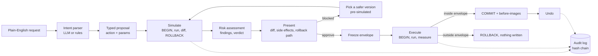

# Architecture snapshot

`intent -> simulate -> present -> execute / rollback`



## Components

| Piece | Responsibility |
|---|---|
| Intent parser | Turns text into `{action, params}`. Never produces SQL. Output is validated and clamped by `coerceParams`. |
| Action catalog | Three typed actions. The same SQL is used by the simulator and the executor, so the preview cannot drift from the real code path. |
| Simulator | Takes a snapshot of every tracked table, runs the action, snapshots again, diffs by primary key, and always rolls back. |
| Risk assessor | Computes metrics from the diff (rows, customers hit, money moved, emails, opted-out recipients, destroyed payments) and applies policy rules to produce findings and a verdict. |
| Tweak engine | Maps findings to parameter patches and simulates each one so the UI shows its effect. |
| Envelope | What the human approved: row ids allowed to change or be deleted, maximum rows created per table, maximum money moved. |
| Executor | Runs the action in a transaction, measures the real diff, compares with the envelope, and commits only if it fits. |
| Undo | Replays before-images: delete what was created, restore changed columns, reinsert deleted rows parents-first. |
| Outbox | Emails are written as `held`, then released after 60 seconds. This is what makes a send recallable. |
| Audit log | Append-only, each entry hashes the previous one. |

## Why the preview is trustworthy

- **Same code path.** A dry run executes the real statements, including triggers and `ON DELETE CASCADE`. Nothing about the preview is generated by a model.
- **Preview and real run are compared.** The effect signature (rows and changed columns, ignoring sequence-assigned ids and timestamps) of the committed run is compared with the preview, and the UI says whether they matched.
- **The preview can still be wrong, so it is not the last line of defense.** The envelope check runs on the real effect, before commit.

## Data flow for one guarded execution

```
approve
  -> BEGIN
  -> snapshot (before)
  -> run action SQL
  -> snapshot (after)  -> diff
  -> checkEnvelope(diff, envelope)
        violations?  yes -> ROLLBACK, report approved vs actual rows
                     no  -> COMMIT, store before-images, compare signature with preview
```

## Where state lives

Postgres runs as WebAssembly in the browser (PGlite) and persists to IndexedDB. The audit log is kept in `localStorage`. There is no server-side database; the only server route is `/api/intent`.
